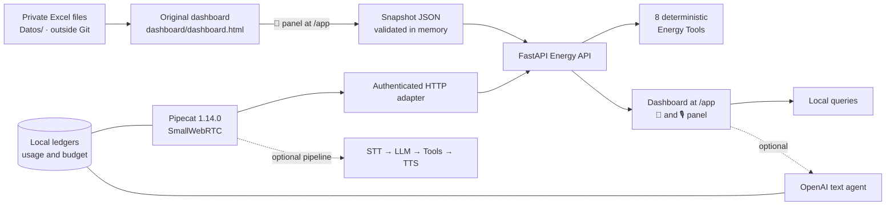

# Vesta 2.0 · energy intelligence assistant

[](https://github.com/IAndy-10/voiceAI-energy-assistant/actions/workflows/tests.yml) [](LICENSE) 

Vesta 2.0 is a local energy-intelligence demo for retail. It keeps Italo's original dashboard, which processes private Excel files in the browser, and adds a FastAPI service with deterministic queries over the snapshot that dashboard generates.

Vesta does not replace the dashboard or its calculations: the backend only queries values already computed in the snapshot. It does not read Excel files, create a database or derive alternative indicators.

The dashboard UI, prompts and the docs in `docs/` are in Spanish (es-CL). UI labels are quoted below as they appear on screen.

## Architecture



Main components:

- **Original dashboard**: processes the five local Excel files in the browser and builds the snapshot. It remains the owner of its calculations.
- **`/app`**: the same dashboard served by the API. Its **💬 Asistente** panel asks for the token, sends the snapshot to the API and offers chat (local or OpenAI) and voice (🎙). It also works on mobile.
- **FastAPI Energy API**: holds a single validated snapshot in memory and protects queries with a Bearer token.
- **Eight Energy Tools**: `get_overview`, `get_store`, `rank_stores`, `get_solar`, `get_chiller`, `get_equipment`, `get_indicators` and `get_data_info` are the authoritative source of energy metrics. Their names, descriptions and arguments are defined once in `energy_contracts/`, shared by the API, the text agent and the voice agent.
- **Vesta `/demo`**: a test page with the tabs Datos y accesos (data and access), Indicadores (indicators), Asistente IA (AI assistant) and Asistente de voz (voice assistant). It loads a snapshot JSON (for example, the synthetic one).
- **Text agent**: OpenAI is optional and keeps an allowlist, limits, `store=false` and a usage ledger.
- **Voice**: Pipecat 1.14.0 orchestrates SmallWebRTC and, when explicitly enabled, the STT → LLM → Energy Tools → TTS cascade.

## Status

| Milestone | Status | Scope |
| --- | --- | --- |
| M03.7 | Implemented and validated | Local energy chat with optional OpenAI, snapshots, authentication, budgets and demo. |
| M04.1 | Implemented | Authenticated HTTP adapter to the Energy Tools (eight today). |
| M04.2 | Implemented and validated in smoke tests | Pipecat 1.14.0 environment, SmallWebRTC client and transport tests. |
| M04.3 | Implemented; manual connection validated | Fourth tab and local SmallWebRTC connection on Windows. |
| M04.4 | Implemented and covered by tests | Optional STT → LLM → Tools → TTS pipeline, allowlist and persistent budget. |
| M04.5 | Ready for manual validation | Controlled procedure for a first conversation. Not declared complete until there is real end-to-end evidence. |
| M04.6 | Implemented and covered by tests | Persistent Pipecat runner, ephemeral per-session authorization and independent text/voice AI controls. |
| M04.7 | Closed with a platform decision | Windows uses native Pipecat; macOS keeps Italo's Docker flow; Linux + Docker awaits a real WebRTC validation. |
| M04.8 | Implemented; validated on macOS | Swappable TTS (OpenAI by default or ElevenLabs Flash v2.5) and per-service latency summary. |
| M04.9 | Implemented; validated from a phone | Remote voice with Cloudflare Tunnel and Twilio TURN; `/start` requires the session grant. |

**The demo is complete.** The next step is testing it with users and gathering feedback; see [Testing and feedback](#testing-and-feedback).

## Requirements

- Docker Desktop with Docker Compose for the dashboard and the Energy API.
- Python 3.11 for the backend; Python 3.12 to run the local Windows Pipecat runner.
- A local API token: `ENERGY_TOOLS_API_TOKEN`.
- Private Excel files and snapshots in `Datos/`, outside Git.
- OpenAI is optional. `OPENAI_API_KEY` belongs only to the backend, or to the local voice process when explicitly authorized.

## Quick start: dashboard, API and demo

1. Create `.env` from `.env.example`, set a unique local Bearer token, and don't commit the file.
2. Keep `OPENAI_ENABLED=false` and `VOICE_PIPELINE_ENABLED=false` for a demo with no external provider.
3. Start the services:

   ```powershell
   docker compose up -d --build
   ```

4. Open [`/app`](http://127.0.0.1:8000/app), drag in the five `.xlsx` files and click **💬 Asistente**.
5. Enter the Bearer token. The panel sends the snapshot to the API and is ready for questions. For voice, also start the `voice` profile (`docker compose --profile voice up -d --build`) and use 🎙.

The snapshot lives in memory only. If the API restarts, the panel sends it again with the next question; after recreating `energy-api`, asking again is also enough.

Alternatives: the [dashboard without the assistant](http://127.0.0.1:8766/dashboard.html) on `:8766`, and the [Vesta demo](http://127.0.0.1:8000/demo), which loads a snapshot JSON under **Datos y accesos** (for a safe test, `Datos\vesta_snapshot_sintetico.json`). The dashboard no longer has a snapshot download button; to validate a real snapshot with `scripts/validate_real_snapshot.py`, run `copy(JSON.stringify(buildSnapshot()))` in the browser console with the `.xlsx` files loaded and save the content as `agent_snapshot.json` (ignored by Git). The `agent-usage` volume keeps only aggregate counters for the text agent; `voice-usage` does the same for the voice container.

## Query modes

- **Consultas locales · Sin OpenAI** (local queries, no OpenAI): uses the deterministic interpreter and the Energy Tools; sends nothing to external providers.
- **Usar OpenAI** (use OpenAI): requires `OPENAI_ENABLED=true` on the server and opting in under **Asistente IA**. The frontend cannot exceed the backend's limits or budgets.
- **Asistente de voz** (voice assistant): `VOICE_PROVIDER=pipecat` is the implemented transport provider. `openai_direct` is a future alternative and is not implemented.

## Voice with Pipecat

The local Windows runner stays separate from `energy-api`. The real pipeline is disabled by default:

```text
VOICE_PROVIDER=pipecat
VOICE_PIPELINE_ENABLED=false
```

### Local Windows runner

`.env` is the single source for the Energy Tools token, global permissions, models, budgets and `OPENAI_API_KEY`. Create `.env` from `.env.example`. If you only need to change the Windows network path, copy `.env.windows.example` to `.env.windows.local`; that file only accepts the local FastAPI URL and the runner's host, port and origins, and it is ignored by Git.

```powershell
docker compose -f compose.yaml -f compose.windows-voice.yaml up -d --build dashboard energy-api
.\scripts\start-voice-windows.ps1
```

That command starts only the dashboard and the API in Docker. On Windows, don't start `voice-agent` or `turn-local`: the browser reaches the native runner at `127.0.0.1:7861` and the API reaches the same process through `host.docker.internal:7861`. If the runner isn't running, written chat stays available and the UI reports that voice is unavailable.

The launcher maps `ENERGY_TOOLS_API_TOKEN` to `VOICE_ENERGY_API_TOKEN` only in the Pipecat child process, so don't duplicate the value in `.env`. With `VOICE_PIPELINE_ENABLED=false` it starts a minimal transport without requiring an OpenAI key. With `true`, it requires the key before starting, but it doesn't call OpenAI or start a session on its own. To review the effective configuration without starting the runner or revealing secrets, use `./scripts/start-voice-windows.ps1 -CheckOnly`.

Stop the Windows runner with `Ctrl+C`. `VOICE_PIPELINE_ENABLED=true` is a global permission: it must be set in both the API and the runner. Once the stack is running, **Usar agente IA de voz** (use the voice AI agent) is selected per session in the UI and does not restart the runner.

```powershell
docker compose up -d --build --force-recreate --no-deps energy-api
```

This clears the in-memory snapshot, so the DEMO JSON must be loaded again after the restart. The full controlled-conversation procedure is in [M04.5](docs/M04.5-FIRST-VOICE-TEST.md).

### Docker voice service and platforms

The Docker path for `voice-agent` and `turn-local` is kept unchanged for macOS, where Italo runs the validation. Its containers use `restart: unless-stopped`:

```powershell
docker compose up -d --build
docker compose down
```

The runner's healthcheck verifies that its HTTP server responds; it does **not** confirm that ICE/WebRTC or audio are connected. Docker Desktop on Windows is not a supported path for WebRTC media: the container's bridge candidates are unreachable from Chrome, and publishing HTTP does not publish WebRTC UDP. Linux + Docker Compose is a production candidate, but it needs a real ICE/audio validation before being declared supported.

### Permissions and per-session activation

`OPENAI_ENABLED` authorizes written chat at most, and `VOICE_PIPELINE_ENABLED` authorizes voice at most. Both start off and are independent. The UI does not change `.env`: the voice checkbox asks the local API, with the Bearer token, for an opaque, single-use, short-lived grant for `minimal` or `ai` mode. The runner consumes that grant before creating STT, LLM or TTS, so a direct request to the runner cannot turn a minimal session into one that spends money.

The screen distinguishes **Runner disponible** (runner available, HTTP probe), **Conectando** (connecting), **Conectado** (connected), **IA de voz activada** (voice AI on) and **Error**. Written chat stays available if the runner is off.

## Configuration, data and security

`.env.example` is the safe configuration reference: it holds names, development values and limits, never real keys.

| Group | Main variables |
| --- | --- |
| Energy API | `ENERGY_TOOLS_API_TOKEN`, `SNAPSHOT_MAX_BYTES`, `VESTA_DEMO_SNAPSHOT_SHA256` |
| Text agent | `OPENAI_ENABLED`, `OPENAI_API_KEY`, `OPENAI_MODEL`, budget, limits on queries, tokens and tool rounds |
| Voice transport | `VOICE_ENABLED`, `VOICE_PROVIDER`, `VOICE_PIPECAT_URL`, session and recording limits |
| Voice pipeline | `VOICE_PIPELINE_ENABLED`, `VOICE_STT_MODEL`, `VOICE_LLM_MODEL`, `VOICE_TTS_MODEL`, `VOICE_TTS_VOICE`, turn limits and budget |
| Voice TTS | `VOICE_TTS_PROVIDER` (`openai` by default or `elevenlabs`), `ELEVENLABS_API_KEY`, `ELEVENLABS_MODEL`, `ELEVENLABS_VOICE` |

The Windows runner takes `VOICE_ENERGY_API_BASE_URL` and its listening settings from `.env.windows.local` (or its safe local defaults), and everything else from `.env`. Variables inherited from PowerShell do not take precedence: the launcher replaces its managed variables while running and restores them when it stops. Conflicts between the two files, and any secret in the Windows file, are rejected. Compose configures the internal equivalent for `voice-agent` and does not expose those values to the browser. `.env` is read at startup: after changing it, restart the Windows runner and recreate only the affected Docker service. It is not synced in real time.

- `.env`, `Datos/`, `data/`, Excel files, snapshots, recordings and ledgers are ignored by Git.
- Whole Excel files or snapshots are never sent to an LLM. The tools read only the active snapshot through the authenticated local API.
- Services published by Compose are bound to `127.0.0.1`.
- Ledgers keep only counters and estimated/aggregate cost; they don't store audio, transcripts or the snapshot.
- Voice reservations are applied before STT, LLM or TTS are built, and they are charged conservatively even if the provider fails.
- An exposed key must be revoked and rotated before it is used again. Never run `docker compose config` with real secrets, because it can expand them in its output.

## Swappable models and roadmap

The planned architecture keeps responsibilities separate:

```text
STT → LLM → eight Energy Tools → TTS
```

- **Current, optional**: OpenAI for STT, LLM and TTS inside Pipecat.
- **Current, optional**: ElevenLabs as TTS (see [ElevenLabs TTS](#elevenlabs-tts)).
- **Future, not implemented**: Ollama with Qwen for Spanish and Gemma for English as a local LLM.
- **Future, not implemented**: Piper as a local TTS.
- **Future, not implemented**: local STT, chosen by Pipecat compatibility.
- **Future, not implemented**: Twilio Voice as a phone channel (today Twilio is used only as TURN for remote voice).

### ElevenLabs TTS

TTS uses OpenAI by default. To use ElevenLabs (WebSocket streaming; on macOS it cut time to first audio from ~1.0 s to ~0.23 s, see [M04.8](docs/M04.8-ELEVENLABS-TTS.md)):

1. Create an API key at https://elevenlabs.io/app/settings/api-keys with text-to-speech permission.
2. In `.env`, set `VOICE_TTS_PROVIDER=elevenlabs` and `ELEVENLABS_API_KEY=...`.
3. Recreate the runner: `docker compose --profile voice up -d --build --force-recreate voice-agent` (on Windows, reinstall `voice_agent/requirements-voice.txt` into `.venv` and restart the launcher). The log shows `tts=elevenlabs/eleven_flash_v2_5/<voice>`.

- The default voice is George (`JBFqnCBsd6RMkjVDRZzb`), a premade voice that works on the free plan but speaks Spanish with an English accent. For another voice, set `ELEVENLABS_VOICE` to a voice ID; Voice Library voices require a paid plan.
- STT and LLM stay on OpenAI. ElevenLabs doesn't accept style instructions, so the tone depends on the voice.
- ElevenLabs charges credits from its plan; the local voice budget (`VOICE_SESSION_BUDGET_USD`) doesn't control them. The real limit is the plan's quota.
- With ElevenLabs on, the text of spoken answers (aggregate figures) is also sent to ElevenLabs.
- If ElevenLabs rejects the request (a voice that doesn't exist, a paid voice on the free plan), Pipecat only logs `TTS context ... completed with no audio` and doesn't show the real error. Clear `ELEVENLABS_VOICE` to go back to the default voice.

### Latency

The runner enables Pipecat metrics, which record each service's time to first byte (TTFB). To summarize them after one or more sessions:

```bash
docker compose logs --since 30m voice-agent | python scripts/voice_latency.py
```

The summary shows n, median, p90 and range per service (`OpenAISTTService`, `OpenAILLMService`, `OpenAITTSService` or `ElevenLabsTTSService`). Compare providers with several similar questions on each.

### Remote voice (Cloudflare Tunnel + Twilio TURN)

For someone on another network to use voice, `/app` and the runner are exposed through Cloudflare HTTPS tunnels and the audio goes through Twilio's TURN. The services stay on `127.0.0.1`. Details and security in [M04.9](docs/M04.9-REMOTE-VOICE.md).

1. Add `TWILIO_ACCOUNT_SID` and `TWILIO_AUTH_TOKEN` to `.env`.
2. Open two tunnels: `cloudflared tunnel --url http://127.0.0.1:8000` and another for `:7860`.
3. In `.env`: set `VOICE_TURN_MODE=twilio`, add the `:8000` tunnel URL to `VOICE_ALLOWED_ORIGINS` and use the `:7860` tunnel URL as `VOICE_PIPECAT_URL`.
4. Run `docker compose --profile voice up -d --build` and test from another network (for example, a phone on mobile data).

Twilio TURN credentials renew themselves before they expire. Close the tunnels when you're done.

## Tests

```powershell
.\.venv\Scripts\python.exe -m pytest -q -p no:cacheprovider
.\.venv\Scripts\python.exe -m compileall -q energy_tools voice_agent
docker compose run --rm --no-deps voice-agent python -m voice_agent.smoke_test
```

The tests use doubles/mocks for OpenAI and ElevenLabs and consume no tokens or credits. The [Tests](.github/workflows/tests.yml) workflow runs them on every push to `main` and every pull request. The real STT → LLM → Tools → TTS conversation runs only when a person enables it manually, and it should be tried with the synthetic snapshot first.

## Known limitations

- SmallWebRTC/Pipecat works with the local Windows runner; the connection from the fourth tab was validated manually.
- Docker Desktop on Windows has no validated direct WebRTC path; use the native runner. A signaling `HTTP 200` does not mean audio is connected.
- On macOS, the Docker flow (`voice-agent` + `turn-local`) is validated end to end with real providers, including from a phone over a tunnel and Twilio TURN. Linux + Docker Compose still awaits a real ICE and audio test.
- `VOICE_PIPELINE_ENABLED=false` is the default and makes no external calls.
- A runner shown as available, or returning `HTTP 200`, does not prove an ICE connection.
- `VOICE_PROVIDER=openai_direct`, Ollama, Piper, local STT and Twilio as a phone channel are not implemented. Twilio is used as TURN for remote voice.

## Collaboration and pull requests

The dashboard and its original specification are preserved. Vesta work happens on `feature/*` branches and is merged through reviewable pull requests into [Italo's](https://github.com/IAndy-10/voiceAI-energy-assistant) original repository. Private data, secrets and runtime artifacts are never included in those reviews.

Suggested review summary: validate the snapshot contract and the eight Energy Tools, run the demo without providers, review the voice HTTP adapter, and agree on the ICE/TURN strategy and local providers before enabling cloud conversations.

## Related documentation (in Spanish)

- [Security and UX, M03.7](docs/M03.7-SECURITY-UX.md)
- [Snapshot contract](docs/INTEGRATION-CONTRACT.md)
- [Data coverage](docs/M03.5-DATA-COVERAGE.md)
- [Pipecat integration, M04.1](docs/M04.1-PIPECAT-INTEGRATION.md)
- [WebRTC, M04.2](docs/M04.2B-PIPECAT-WEBRTC.md)
- [Remote voice, M04.9](docs/M04.9-REMOTE-VOICE.md)
- [Voice architecture, M04.3](docs/M04.3-VOICE-ARCHITECTURE.md)
- [Energy Tools pipeline, M04.4](docs/M04.4-PIPECAT-ENERGY-PIPELINE.md)
- [First controlled conversation, M04.5](docs/M04.5-FIRST-VOICE-TEST.md)
- [Windows diagnosis and decision, M04.7](docs/M04.7-WEBRTC-WINDOWS-DIAGNOSIS.md)
- [ElevenLabs TTS and latency, M04.8](docs/M04.8-ELEVENLABS-TTS.md)
- [Original demo specification](docs/multicentro_energy_manager_demo_spec.md)
- [Learnings: voice, containers and WebRTC](docs/LEARNINGS.md)

## Testing and feedback

The demo is feature-complete. To test it with someone else:

1. Start the stack with voice and, if the person is on another network, the tunnels (see [Remote voice](#remote-voice-cloudflare-tunnel--twilio-turn)).
2. Send the `/app` URL and the token through separate channels. Use a new token just for the test and rotate it afterwards.
3. Check the voice budget beforehand (`VOICE_BUDGET_USD`; each session reserves the full `VOICE_SESSION_BUDGET_USD`) and the latency afterwards with `scripts/voice_latency.py`.
4. For each question, note: what was asked, whether the figure and period were correct, whether voice cut off the question, the perceived delay, and any UI problem (especially on mobile).

Known follow-ups: repeat the remote test from a phone with the `/start` protection, run a voice session on Windows with `start-voice-windows.ps1`, and tune the end-of-turn silence if STT cuts off questions with pauses.

## License

Vesta's source code is released under the [MIT License](LICENSE).
