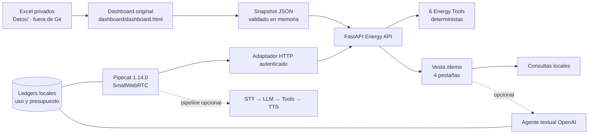

# Vesta 2.0 · asistente de inteligencia energética

Vesta 2.0 es una demostración local de inteligencia energética para retail. Conserva el dashboard original de Ítalo, que procesa Excel privados en el navegador, y añade una API FastAPI con consultas deterministas sobre el snapshot generado por ese dashboard.

La contribución Vesta no reemplaza el dashboard ni sus cálculos: el backend consulta exclusivamente valores ya calculados en el snapshot. No lee Excel, no crea una base de datos ni deriva indicadores alternativos.

## Arquitectura



Componentes principales:

- **Dashboard original**: procesa los cinco Excel locales y exporta el contrato de snapshot. Sigue siendo propietario de sus cálculos.
- **FastAPI Energy API**: mantiene un único snapshot validado en memoria y protege las consultas con Bearer.
- **Seis Energy Tools**: `get_overview`, `get_store`, `rank_stores`, `get_solar`, `get_chiller` y `get_data_info` son la fuente autorizada de métricas energéticas.
- **Vesta `/demo`**: ofrece Datos y accesos, Indicadores, Asistente IA y Asistente de voz.
- **Agente textual**: OpenAI es opcional y conserva allowlist, límites, `store=false` y ledger de uso.
- **Voz**: Pipecat 1.14.0 orquesta SmallWebRTC y, cuando se habilita explícitamente, la cascada STT → LLM → Energy Tools → TTS.

## Estado funcional

| Hito | Estado | Alcance |
| --- | --- | --- |
| M03.7 | Implementado y validado | Chat energético local/OpenAI opcional, snapshots, autenticación, presupuestos y demo. |
| M04.1 | Implementado | Adaptador HTTP autenticado hacia las seis Energy Tools. |
| M04.2 | Implementado y validado en smoke tests | Entorno Pipecat 1.14.0, cliente SmallWebRTC y pruebas de transporte. |
| M04.3 | Implementado; conexión manual validada | Cuarta pestaña y conexión SmallWebRTC local en Windows. |
| M04.4 | Implementado y cubierto por pruebas | Pipeline opcional STT → LLM → Tools → TTS, allowlist y presupuesto persistente. |
| M04.5 | Preparado para validación manual | Procedimiento controlado para una primera conversación. No se declara completado hasta obtener evidencia real extremo a extremo. |
| M04.6 | Implementado y cubierto por pruebas | Runner Pipecat persistente, autorización efímera por sesión y controles de IA textual/voz independientes. |

## Requisitos

- Docker Desktop con Docker Compose para dashboard y Energy API.
- Python 3.11 para el backend; Python 3.12 para ejecutar el runner Pipecat local de Windows.
- Un token local para la API: `ENERGY_TOOLS_API_TOKEN`.
- Excel y snapshots privados en `Datos/`, fuera de Git.
- OpenAI es opcional. `OPENAI_API_KEY` solo pertenece al backend o al proceso local de voz cuando exista autorización explícita.

## Inicio rápido: dashboard, API y demo

1. Cree `.env` a partir de `.env.example`, defina un Bearer local único y no suba el archivo a Git.
2. Mantenga `OPENAI_ENABLED=false` y `VOICE_PIPELINE_ENABLED=false` para una demo sin proveedor externo.
3. Inicie los servicios:

   ```powershell
   docker compose up -d --build
   ```

4. Abra el [dashboard original](http://127.0.0.1:8766/dashboard.html) y la [demo Vesta](http://127.0.0.1:8000/demo).
5. En **Datos y accesos**, ingrese el Bearer, elija el JSON exportado por el dashboard y pulse **Cargar snapshot**. Para una prueba segura use `Datos\vesta_snapshot_sintetico.json`.

El snapshot vive solo en memoria. Tras recrear `energy-api` debe cargarse otra vez. El volumen `agent-usage` conserva solo contadores agregados del agente textual; `voice-usage` cumple la misma función para el contenedor de voz.

## Modos de consulta

- **Consultas locales · Sin OpenAI**: usa el intérprete determinista y Energy Tools; no envía información a proveedores externos.
- **Usar OpenAI**: requiere `OPENAI_ENABLED=true` en el servidor y activación voluntaria en **Asistente IA**. El frontend no puede superar límites ni presupuestos del backend.
- **Asistente de voz**: `VOICE_PROVIDER=pipecat` es el proveedor de transporte implementado. `openai_direct` es una alternativa futura y no está implementada.

## Voz con Pipecat

El runner local de Windows se mantiene separado de `energy-api`. El pipeline real se encuentra desactivado de forma predeterminada:

```text
VOICE_PROVIDER=pipecat
VOICE_PIPELINE_ENABLED=false
```

### Runner local Windows

`.env` es la fuente única para el token de Energy Tools, permisos globales, modelos, presupuestos y `OPENAI_API_KEY`. Cree `.env` desde `.env.example`. Si necesita cambiar solo la ruta de red de Windows, copie `.env.windows.example` a `.env.windows.local`; ese archivo admite únicamente la URL local de FastAPI, host, puerto y orígenes del runner, y está ignorado por Git.

```powershell
docker compose -f compose.yaml -f compose.windows-voice.yaml up -d
.\scripts\start-voice-windows.ps1
```

El lanzador mapea `ENERGY_TOOLS_API_TOKEN` a `VOICE_ENERGY_API_TOKEN` solo en el proceso hijo de Pipecat: no duplique el valor en `.env`. Con `VOICE_PIPELINE_ENABLED=false` inicia transporte mínimo sin requerir una clave OpenAI. Con valor `true`, exige la clave antes de arrancar, pero no realiza una llamada OpenAI ni inicia una sesión por sí mismo. Para revisar la configuración efectiva sin arrancar el runner ni revelar secretos use `./scripts/start-voice-windows.ps1 -CheckOnly`.

Detenga el runner Windows con `Ctrl+C`. `VOICE_PIPELINE_ENABLED=true` es un permiso global: debe existir tanto en la API como en el runner. Una vez iniciado el stack, la selección de **Usar agente IA de voz** se realiza por sesión en la UI y no reinicia el runner.

```powershell
docker compose up -d --build --force-recreate --no-deps energy-api
```

Esto vacía el snapshot en memoria, por lo que debe volver a cargar el JSON DEMO después del reinicio. El procedimiento completo de conversación controlada está en [M04.5](docs/M04.5-FIRST-VOICE-TEST.md).

### Servicio de voz Docker

`voice-agent` y `turn-local` forman parte del arranque habitual y usan `restart: unless-stopped`. Inicie o detenga todo el stack así:

```powershell
docker compose up -d --build
docker compose down
```

El healthcheck del runner comprueba que su HTTP responda; **no** confirma que ICE/WebRTC ni el audio estén conectados. Para usar el runner Windows validado sin editar Compose, aplique `compose.windows-voice.yaml`: expone `127.0.0.1:7861` al navegador y usa `host.docker.internal:7861` desde `energy-api`. La conectividad ICE/TURN de Docker Desktop sigue siendo una limitación conocida.

### Permisos y activación por sesión

`OPENAI_ENABLED` autoriza como máximo el chat escrito y `VOICE_PIPELINE_ENABLED` autoriza como máximo la voz. Ambos parten apagados y son independientes. La UI no cambia `.env`: el checkbox de voz solicita a la API local, con Bearer, una autorización opaca de un solo uso y corta duración para modo `minimal` o `ai`. El runner consume esa autorización antes de crear STT, LLM o TTS; una solicitud directa al runner no puede convertir una sesión mínima en una sesión con gasto.

La pantalla distingue **Runner disponible** (sonda HTTP), **Conectando**, **Conectado**, **IA de voz activada** y **Error**. El chat escrito continúa disponible si el runner está apagado.

## Configuración, datos y seguridad

`.env.example` es la referencia de configuración segura: contiene nombres, valores de desarrollo y límites, nunca claves reales.

| Grupo | Variables principales |
| --- | --- |
| Energy API | `ENERGY_TOOLS_API_TOKEN`, `SNAPSHOT_MAX_BYTES`, `VESTA_DEMO_SNAPSHOT_SHA256` |
| Agente textual | `OPENAI_ENABLED`, `OPENAI_API_KEY`, `OPENAI_MODEL`, presupuesto, límites de consultas, tokens y rondas de tools |
| Transporte de voz | `VOICE_ENABLED`, `VOICE_PROVIDER`, `VOICE_PIPECAT_URL`, límites de sesión y grabación |
| Pipeline de voz | `VOICE_PIPELINE_ENABLED`, `VOICE_STT_MODEL`, `VOICE_LLM_MODEL`, `VOICE_TTS_MODEL`, `VOICE_TTS_VOICE`, límites de turnos y presupuesto |

El runner Windows toma `VOICE_ENERGY_API_BASE_URL` y sus datos de escucha desde `.env.windows.local` (o sus valores locales seguros) y el resto desde `.env`. Las variables heredadas de PowerShell no tienen precedencia: el lanzador reemplaza sus variables administradas durante la ejecución y las restaura al detenerse. Los conflictos entre ambos archivos y cualquier secreto en el archivo Windows se rechazan. Compose configura el equivalente interno para `voice-agent`; no expone esos valores al navegador. `.env` se lee al inicio: al cambiarlo, reinicie el runner Windows y recree solo el servicio Docker afectado. No es sincronización en tiempo real.

- `.env`, `Datos/`, `data/`, Excel, snapshots, grabaciones y ledgers están ignorados por Git.
- No se envían Excel completos ni snapshots completos a un LLM. Las herramientas leen solo el snapshot activo por medio de la API local autenticada.
- Los servicios publicados por Compose se restringen a `127.0.0.1`.
- Los ledgers conservan únicamente contadores y costo estimado/agregado; no guardan audio, transcripciones ni el snapshot.
- Las reservas de voz se aplican antes de construir STT, LLM o TTS y se contabilizan conservadoramente incluso ante fallo del proveedor.
- Una clave expuesta debe revocarse y rotarse antes de volver a utilizarla. Nunca ejecute `docker compose config` con secretos reales, porque podría expandirlos en la salida.

## Modelos intercambiables y roadmap

La arquitectura prevista mantiene responsabilidades separadas:

```text
STT → LLM → seis Energy Tools → TTS
```

- **Actual y opcional**: OpenAI para STT, LLM y TTS dentro de Pipecat.
- **Futuro, no implementado**: Ollama con Qwen para español y Gemma para inglés como LLM local.
- **Futuro, no implementado**: Piper como TTS local.
- **Futuro, no implementado**: STT local, a elegir según compatibilidad con Pipecat.
- **Futuro, fuera de este PR**: Twilio como canal telefónico.

## Pruebas

```powershell
.\.venv\Scripts\python.exe -m pytest -q -p no:cacheprovider
.\.venv\Scripts\python.exe -m compileall -q energy_tools voice_agent
docker compose run --rm --no-deps voice-agent python -m voice_agent.smoke_test
```

Las pruebas usan dobles/mocks para OpenAI y no consumen tokens. La conversación real STT → LLM → Tools → TTS se ejecuta solo cuando una persona la habilita manualmente y debe probarse primero con el snapshot sintético.

## Limitaciones conocidas

- SmallWebRTC/Pipecat funciona con el runner local de Windows; la conexión desde la cuarta pestaña fue validada manualmente.
- Docker Desktop presenta dificultades de ICE/TURN para WebRTC. Un `HTTP 200` de señalización no equivale a audio conectado.
- La conversación completa con proveedores reales todavía está pendiente de validación extremo a extremo.
- `VOICE_PIPELINE_ENABLED=false` es el valor inicial y no realiza llamadas externas.
- Que el runner figure disponible o devuelva `HTTP 200` no prueba una conexión ICE; Docker Desktop sigue pendiente de validación manual desde Chrome.
- `VOICE_PROVIDER=openai_direct`, Ollama, Piper, STT local y Twilio no están implementados.

## Colaboración y Pull Requests

El dashboard y su especificación original se preservan. Los desarrollos de Vesta se realizan en ramas `feature/*` y se integran mediante Pull Requests revisables hacia el repositorio original de [Ítalo](https://github.com/IAndy-10/voiceAI-energy-assistant). No se integran datos privados, secretos ni artefactos de ejecución en esas revisiones.

Resumen sugerido para revisión: validar el contrato de snapshot y las seis Energy Tools, ejecutar la demo sin proveedores, revisar el adaptador HTTP de voz y acordar la estrategia ICE/TURN y proveedores locales antes de habilitar conversaciones cloud.

## Documentación relacionada

- [Seguridad y UX M03.7](docs/M03.7-SECURITY-UX.md)
- [Contrato del snapshot](docs/INTEGRATION-CONTRACT.md)
- [Cobertura de datos](docs/M03.5-DATA-COVERAGE.md)
- [Integración Pipecat M04.1](docs/M04.1-PIPECAT-INTEGRATION.md)
- [WebRTC M04.2](docs/M04.2B-PIPECAT-WEBRTC.md)
- [Arquitectura de voz M04.3](docs/M04.3-VOICE-ARCHITECTURE.md)
- [Pipeline Energy Tools M04.4](docs/M04.4-PIPECAT-ENERGY-PIPELINE.md)
- [Primera conversación controlada M04.5](docs/M04.5-FIRST-VOICE-TEST.md)
- [Especificación original de demostración](docs/multicentro_energy_manager_demo_spec.md)
